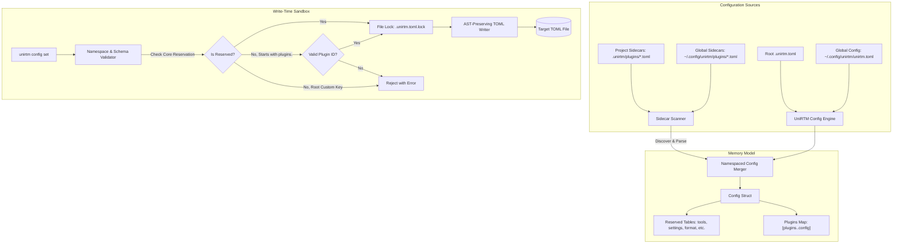

# Implementation Plan: Plugin & Extension Configuration Namespace Isolation

**Feature Branch**: `027-plugin-config-isolation`  
**Spec**: [spec.md](./spec.md)  
**Status**: Draft  

---

## 1. Technical Architecture & Component Overview



---

## 2. Component Design Breakdown

### Component 1: Reserved Namespace Registry (`internal/config/reserved.go`)
* Maintain a frozen map of officially recognized root tables:
  ```go
  var ReservedCoreTables = map[string]bool{
      "tools":    true,
      "tasks":    true,
      "format":   true,
      "lint":     true,
      "hooks":    true,
      "env":      true,
      "settings": true,
      "plugins":  true,
  }
  ```
* Provide validation function `ValidateKeyNamespace(key string) error`:
  * If key starts with a reserved table: allowed.
  * If key starts with `plugins.`: extract plugin ID and validate against valid identifier regex (`^[a-zA-Z0-9_.-]+(/[a-zA-Z0-9_.-]+)?$`).
  * Otherwise: reject with clear message directing users to use `plugins."<id>".config`.

### Component 2: Plugin Model & In-Memory Structs (`internal/config/plugin.go`)
* Expand `Config` struct to cleanly capture plugins:
  ```go
  type PluginDeclaration struct {
      Version string                 `toml:"version,omitempty"`
      Config  map[string]interface{} `toml:"config,omitempty"`
  }

  type Config struct {
      // Core tables...
      Plugins map[string]PluginDeclaration `toml:"plugins,omitempty"`
  }
  ```

### Component 3: Sidecar Scanner & Merger (`internal/config/sidecar.go`)
* **Project Directory**: Look for `.unirtm/plugins/*.toml`.
* **Global Directory**: Look for `~/.config/unirtm/plugins/*.toml`.
* **Mapping Rule**: The basename of the sidecar file (without `.toml`) maps to the plugin ID. (e.g. `docker.toml` -> `plugins.docker.config`, or URL-encoded `snowdreamtech-docker.toml`).
* **Deep Merge Rule**:
  1. Base: Sidecar configuration map.
  2. Overlay: Inline `[plugins."<id>".config]` from `.unirtm.toml`.
  3. Inline always wins conflicts over Sidecar files.

### Component 4: AST-Preserving Serializer & File Lock (`internal/config/writer.go`)
* Use an AST-based TOML modifier (preserving comments and whitespaces) or targeted section writer.
* **File Lock**:
  * Acquire exclusive lock on target file (`targetFile + ".lock"`) using standard OS file locking (`syscall.Flock` on Unix, `LockFileEx` on Windows).
  * Automatically release lock via `defer`.
  * Timeout after 5 seconds if another process is holding the lock.

### Component 5: Manifest Schema Validator (`internal/config/schema.go`)
* Provide optional schema checking when writing configurations:
  * Check type: `string`, `int`, `bool`, `list`, `map`.
  * Check enums: if allowed values are declared.
  * Return user-friendly formatting error if input value doesn't conform.

---

## 3. Implementation Phases

| Phase | Focus Area | Deliverables |
| :--- | :--- | :--- |
| **Phase 1: Setup & Data Modeling** | Model & Reserved Registry | `internal/config/reserved.go`, update `Config` struct with `Plugins` map |
| **Phase 2: Validation & CLI Guard** | Write Sandbox & CLI Protection | Update `runConfigSet` in `cmd/14.config.go` with namespace enforcement |
| **Phase 3: Sidecar Engine** | File Scanner & Merger | `internal/config/sidecar.go`, auto-merging during `LoadHierarchy` |
| **Phase 4: AST Preservation & Concurrency** | Atomic File Locking | Implement `.unirtm.toml.lock` and safe serializer in `internal/config/writer.go` |
| **Phase 5: Schema Validation & UI Display** | Validation & UI Inspection | Manifest schema checking, display plugin section in `unirtm config` and `unirtm ui` |

---

## 4. Verification & Testing Strategy

1. **Unit Tests**:
   - `reserved_test.go`: Test that all core tables pass and illegal root tables are rejected.
   - `sidecar_test.go`: Test discovery, precedence (inline overrides sidecar), and parsing of `.unirtm/plugins/*.toml`.
   - `writer_test.go`: Test that comments in `.unirtm.toml` are preserved across `unirtm config set` invocations.
   - `lock_test.go`: Simulate parallel processes writing concurrently to verify lock contention and zero data corruption.
2. **CLI Integration Tests**:
   - `unirtm config set plugins."my/plugin".config.port 8080` succeeds.
   - `unirtm config set invalid_plugin.key val` fails with clear instruction.
   - `unirtm config get plugins."my/plugin".config.port` returns `8080`.
