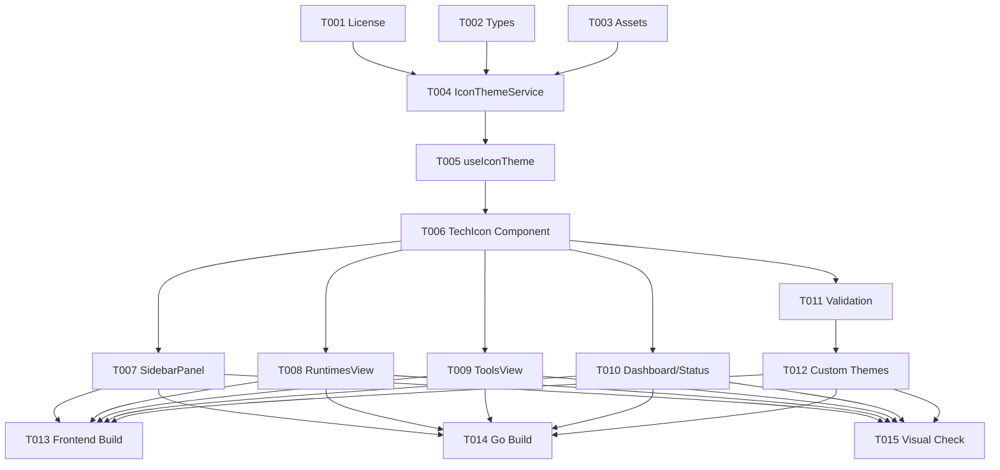

# Tasks: VS Code Icon Theme 100% Specification Alignment

**Input**: Design documents from `/specs/030-vscode-icon-theme/`
**Prerequisites**: [plan.md](plan.md), [spec.md](spec.md), [research.md](research.md), [data-model.md](data-model.md), [contracts/icon-theme-schema.json](contracts/icon-theme-schema.json)

## Format: `[ID] [P?] [Story] Description`

- **[P]**: Can run in parallel (different files, no dependencies)
- **[Story]**: Which user story this task belongs to (e.g., US1, US2, US3, US4)
- Include exact file paths in descriptions

---

## Phase 1: Setup (Assets, Types & Licensing)

**Purpose**: Establish type definitions, vendor default Seti UI assets, and verify license compliance.

- [x] T001 [P] [US4] Create or update `THIRD-PARTY-LICENSES.md` at repository root with MIT and CC-BY-SA 4.0 attributions for VS Code and Seti UI assets.
- [x] T002 [P] [US3] Create `frontend/src/types/icon-theme.ts` declaring 100% VS Code compatible interfaces (`IconThemeManifest`, `IconDefinition`, `IconFontDefinition`, `ResolvedIcon`).
- [x] T003 [P] [US1] Vendor canonical Seti UI assets (`seti.woff` and `seti.json`) under `frontend/src/assets/themes/seti/`.

---

## Phase 2: Foundational (Engine & Universal Component)

**Purpose**: Core icon theme engine and universal `<TechIcon>` component that all views depend upon.

**⚠️ CRITICAL**: Must be completed before views can be refactored.

- [x] T004 [US2] Implement `IconThemeService` in `frontend/src/services/icon-theme/iconThemeService.ts` with manifest parsing, `@font-face` dynamic CSS stylesheet injection, and $O(1)$ multi-tier resolution (`fileNames` -> `fileExtensions` -> `languageIds` -> `file` default).
- [x] T005 [US2] Implement Vue composable `useIconTheme` in `frontend/src/composables/useIconTheme.ts` exposing `resolveIcon(id)` and `activeTheme`.
- [x] T006 [US2] Implement universal `<TechIcon>` component in `frontend/src/components/common/TechIcon.vue` supporting customizable `id`, `size`, `colored`, and class customization.

**Checkpoint**: Foundation ready. `<TechIcon id="go" />`, `<TechIcon id="node" />`, `<TechIcon id="unirtm.lock" />` can now render Seti vector icons correctly.

---

## Phase 3: User Story 1 & 2 - Workbench Migration (Priority: P1) 🎯 MVP

**Goal**: Replace all hardcoded emojis and switch statements across the entire UniRTM workbench with `<TechIcon>`.

**Independent Test**: Open Runtimes, Sidebar, and Tools views; all runtimes (Go, Node.js, Python, Rust, PHP, Java, etc.) render crisp, official Seti vector icons with brand colors.

- [x] T007 [P] [US1] Refactor `frontend/src/components/layout/SidebarPanel.vue` to replace runtime and tool emoji mappings (`🔷`, `🟢`, `🐍`, `🦀`) with `<TechIcon :id="item.id" :size="16" />`.
- [x] T008 [P] [US1] Refactor `frontend/src/views/RuntimesView.vue` to delete `getRuntimeIcon()` switch statement and replace preset/card icons with `<TechIcon :id="runtime.id" :size="28" :colored="true" />`.
- [x] T009 [P] [US1] Refactor `frontend/src/views/ToolsView.vue` to replace tool emojis with `<TechIcon :id="tool.id" :size="24" :colored="true" />`.
- [x] T010 [P] [US1] Refactor `frontend/src/views/DashboardView.vue` and `frontend/src/components/layout/BottomStatusBar.vue` to replace any remaining hardcoded tool emojis.

**Checkpoint**: Workbench is 100% free of hardcoded emojis; all tool/language icons render via the declarative engine.

---

## Phase 4: User Story 3 - Extensibility & Custom Theme Support (Priority: P2)

**Goal**: Support external custom icon theme registration and graceful fallback.

**Independent Test**: Load a custom or partial `icon-theme.json` file; unrecognized tools gracefully fall back to the theme's `default` file icon without console warnings.

- [x] T011 [US3] Add validation and error boundary in `frontend/src/services/icon-theme/iconThemeService.ts` ensuring corrupted manifests fall back safely to built-in Seti.
- [x] T012 [US3] Implement `registerCustomTheme(manifest)` API allowing dynamic runtime addition of third-party icon themes.

---

## Phase 5: Verification & Polish

**Purpose**: Build verification, performance check, and cross-theme validation.

- [x] T013 [P] Run `npm run build` in `frontend/` to ensure zero TypeScript errors (`vue-tsc`) and clean production bundle.
- [x] T014 [P] Run `go build -o bin/unirtm main.go` to ensure embedded assets build cleanly into single binary.
- [x] T015 Verify visual presentation across dark and light themes (contrast, alignment, font scaling).

---

## Dependencies & Execution Order

