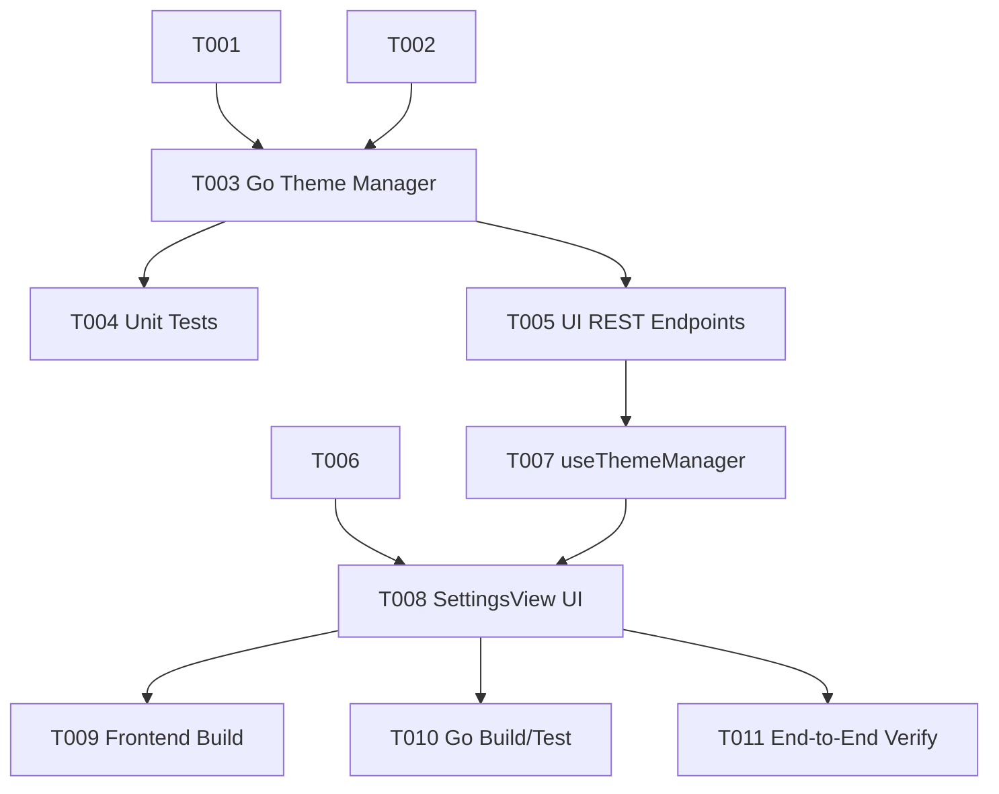

# Tasks: VS Code Compatible Theme and Icon Management System

**Input**: Design documents from `/specs/031-vscode-theme-manager/`
**Prerequisites**: [plan.md](plan.md), [spec.md](spec.md), [research.md](research.md), [data-model.md](data-model.md), [contracts/themes-api.json](contracts/themes-api.json)

## Format: `[ID] [P?] [Story] Description`

- **[P]**: Can run in parallel (different files, no dependencies)
- **[Story]**: Which user story this task belongs to (e.g., US1, US2, US3)
- Include exact file paths in descriptions

---

## Phase 1: Setup & Data Models

**Purpose**: Establish backend and frontend data structures.

- [ ] T001 [P] [US1] Create Go theme model types and standard directory resolver in `internal/theme/types.go`.
- [ ] T002 [P] [US1] Create frontend TypeScript theme management interfaces in `frontend/src/types/theme-manager.ts`.

---

## Phase 2: Foundational (Backend Theme Engine & REST Endpoints)

**Purpose**: Core backend implementation for theme discovery, `.vsix` unpacking, and REST endpoints.

**⚠️ CRITICAL**: Must be completed before frontend API integration.

- [ ] T003 [US1/US2] Implement `internal/theme/manager.go` supporting:
  - Standard user directory initialization (`~/.local/share/unirtm/themes/{icons,colors}`)
  - Theme scanner parsing `package.json` for `contributes.themes` and `contributes.iconThemes`
  - Safe `.vsix` / `.zip` archive unpacker
  - Theme uninstaller (directory deletion)
- [ ] T004 [P] [US1/US2] Implement unit tests in `internal/theme/manager_test.go` verifying discovery, zip unpacking, and path sanitization.
- [ ] T005 [US1/US2] Wire theme endpoints into `cmd/64.ui.go`:
  - `GET /api/themes` (list all installed + builtin themes)
  - `POST /api/themes/install` (multipart upload & extraction of `.vsix`)
  - `DELETE /api/themes` (uninstall theme by type and id)
  - `POST /api/themes/apply` (persist active themes in user config)
  - `GET /api/themes/assets/*` (serve unpacked font and SVG assets)

**Checkpoint**: Backend theme APIs fully functional and tested via unit tests.

---

## Phase 3: Frontend Composable & Color Token Bridge (Priority: P1)

**Purpose**: Reactive frontend services to hot-switch themes and bridge VS Code color tokens.

- [ ] T006 [P] [US3] Implement `frontend/src/composables/useColorTheme.ts` mapping standard VS Code workbench colors (`activityBar.background`, `sideBar.background`, `editor.background`, `statusBar.background`, `foreground`) to CSS variables.
- [ ] T007 [P] [US3] Implement `frontend/src/composables/useThemeManager.ts` managing API requests (`fetchThemes`, `installTheme`, `deleteTheme`, `applyTheme`).

---

## Phase 4: Workbench UI (SettingsView Theme Manager) (Priority: P1) 🎯 MVP

**Goal**: Full GUI management in Settings -> Appearance.

**Independent Test**: User can upload `.vsix`, see it appear in the dropdown, switch to it with live visual change, and delete it.

- [ ] T008 [US3] Add "Theme & Icon Management" section to `frontend/src/views/SettingsView.vue`:
  - Dropdown pickers for active Color Theme and Icon Theme
  - "Install Theme (.vsix)" file upload button
  - Installed Themes list with delete buttons

**Checkpoint**: User can install, apply, and delete themes completely through the UI.

---

## Phase 5: Verification & Packaging

**Purpose**: Full build validation and regression check.

- [ ] T009 [P] Run `npm run build` in `frontend/` to verify zero TypeScript errors.
- [ ] T010 [P] Run `go test ./internal/theme/...` and build Go binary (`go build -o bin/unirtm main.go`).
- [ ] T011 Verify hot-switching and persistence end-to-end.

---

## Dependencies & Execution Order

