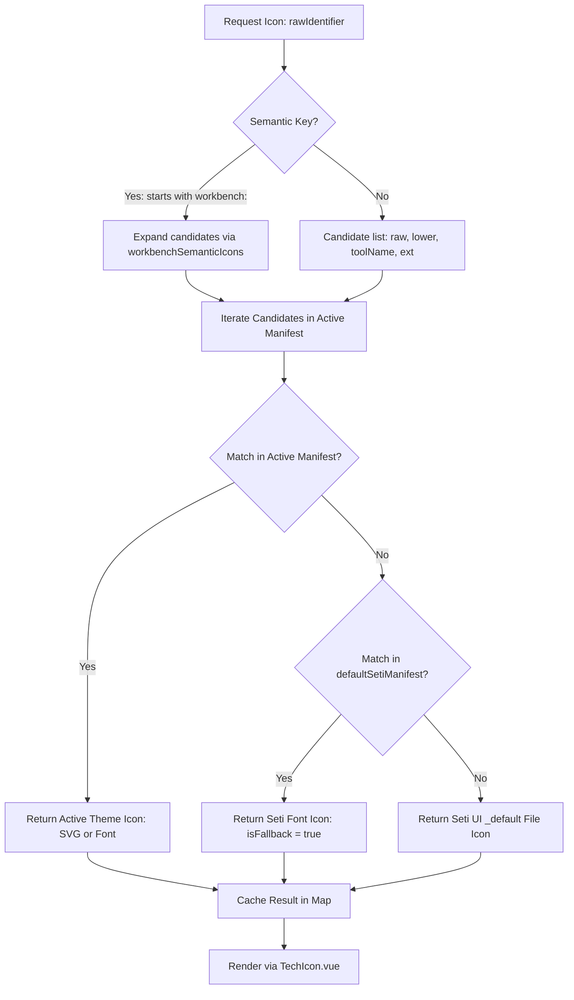

# Data Model: Dynamic Icon Themes & Seti Fallback

## 1. Entities & Types

### 1.1 `WorkbenchIconKey`
Semantic identifiers used across UniRTM Workbench views:
- `workbench:dashboard`
- `workbench:runtimes`
- `workbench:tools`
- `workbench:tasks`
- `workbench:marketplace`
- `workbench:doctor`
- `workbench:settings`
- `workbench:about`
- `workbench:terminal`
- `workbench:logs`
- `workbench:lock`
- `workbench:config`
- `workbench:success`
- `workbench:warning`
- `workbench:error`
- `workbench:info`

### 1.2 `SemanticIconMapping`
```typescript
export interface SemanticIconMapping {
  /** Target candidate names to search in theme manifest (fileNames -> fileExtensions -> languageIds) */
  candidates: string[];
  /** Default Seti fallback definition key if no candidate matches active theme */
  fallbackSetiKey: string;
}
```

### 1.3 `ResolvedIcon`
```typescript
export interface ResolvedIcon {
  type: "font" | "svg";
  fontFamily?: string;
  character?: string;
  color?: string;
  fontSize?: string;
  svgPath?: string;
  definitionKey?: string;
  isFallback?: boolean;
}
```

### 1.4 State Transitions & Flow


