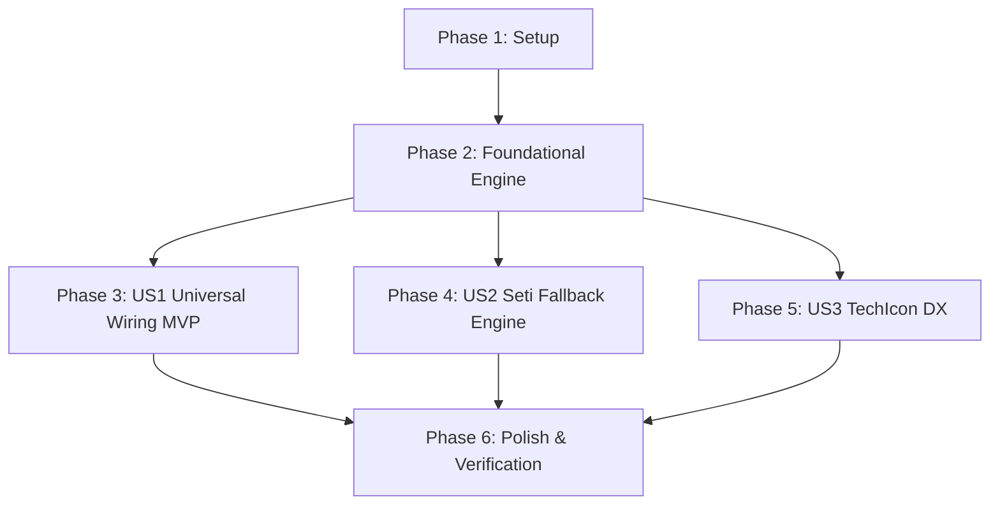

# Tasks: Dynamic Icon Themes & Seti UI Fallback (033-dynamic-icon-themes-and-seti-fallback)

**Input**: Design documents from `/specs/033-dynamic-icon-themes-and-seti-fallback/`
- Spec: [spec.md](spec.md)
- Plan: [plan.md](plan.md)
- Research: [research.md](research.md)
- Data Model: [data-model.md](data-model.md)
- Contracts: [contracts/icon-theme-contract.md](contracts/icon-theme-contract.md)
- Quickstart: [quickstart.md](quickstart.md)

---

## Phase 1: Setup (Shared Infrastructure)

**Purpose**: Initialize workbench semantic dictionary and enhance type definitions

- [ ] T001 Define `WorkbenchIconKey` and `SemanticIconMapping` types in `frontend/src/types/icon-theme.ts`
- [ ] T002 [P] Create centralized semantic icon dictionary `workbenchSemanticIcons` in `frontend/src/services/icon-theme/workbenchIcons.ts`

---

## Phase 2: Foundational (Blocking Prerequisites)

**Purpose**: Core resolution engine with multi-tier Seti UI fallback & LRU caching

**⚠️ CRITICAL**: Must be completed before views can reliably resolve semantic and fallback icons

- [ ] T003 Implement multi-tier resolution (Active Theme $\rightarrow$ Seti Exact $\rightarrow$ Seti `_default`) with in-memory caching in `frontend/src/services/icon-theme/iconThemeService.ts`
- [ ] T004 Enhance `<TechIcon>` component in `frontend/src/components/common/TechIcon.vue` to support semantic workbench keys, `:colored="false"` color inheritance, and seamless SVG/Font hybrid rendering
- [ ] T005 [P] Expose semantic icon helper methods in `frontend/src/composables/useIconTheme.ts`

**Checkpoint**: Core engine ready. Any component can call `<TechIcon id="workbench:..." />` with guaranteed Seti fallback.

---

## Phase 3: User Story 1 - 全面图标集接入与全局动态更换 (Priority: P1) 🎯 MVP

**Goal**: Replace all hardcoded Unicode Emojis across UniRTM Workbench navigation and views with dynamic `<TechIcon>` driven by icon themes.

**Independent Test**: Switch between icon themes in Settings / Marketplace; all navigation bars, sidebars, dashboard cards, doctor items, tasks, and settings tabs update their visual icons in real time without any native system Emoji.

### Implementation for User Story 1
- [ ] T006 [P] [US1] Refactor `ActivityBar.vue` to replace primary and utility emojis (📊, 🌐, 🛠️, ⚡, 🧩, 🩺, ⚙️, ℹ️, 📜) with `<TechIcon>` in `frontend/src/components/layout/ActivityBar.vue`
- [ ] T007 [P] [US1] Refactor `SidebarPanel.vue` to replace navigation and status section emojis with `<TechIcon>` in `frontend/src/components/layout/SidebarPanel.vue`
- [ ] T008 [P] [US1] Refactor `DashboardView.vue` to replace system cards, activity logs, and metric emojis with `<TechIcon>` in `frontend/src/views/DashboardView.vue`
- [ ] T009 [P] [US1] Refactor `DoctorView.vue` to replace diagnostics checklist status and category emojis with `<TechIcon>` in `frontend/src/views/DoctorView.vue`
- [ ] T010 [P] [US1] Refactor `TasksView.vue` to replace task run icons, status indicators, and execution emojis with `<TechIcon>` in `frontend/src/views/TasksView.vue`
- [ ] T011 [P] [US1] Refactor `MarketplaceView.vue` to replace plugin/extension badges and category emojis with `<TechIcon>` in `frontend/src/views/MarketplaceView.vue`
- [ ] T012 [P] [US1] Refactor `SettingsView.vue` to replace navigation tabs and section emojis with `<TechIcon>` in `frontend/src/views/SettingsView.vue`
- [ ] T013 [US1] Refactor `BottomStatusBar.vue` to ensure all status chips and quick action buttons use `<TechIcon>` in `frontend/src/components/layout/BottomStatusBar.vue`

**Checkpoint**: Entire Web Workbench is 100% free of hardcoded Unicode Emojis and dynamically reflects active icon theme.

---

## Phase 4: User Story 2 - 第三方图标缺失时优雅回退到 Seti UI (Priority: P1)

**Goal**: Automatically and seamlessly fallback to Seti UI when third-party icon themes have missing definitions, ensuring zero broken icons or blank glyphs.

**Independent Test**: Load a theme that lacks obscure language or workbench definitions (e.g. `unirtm.lock`, `zig`, `gleam`, or unknown tools); verify that it gracefully falls back to the exact Seti UI glyph, or `_default` (`\uE023`).

### Implementation for User Story 2
- [ ] T014 [US2] Verify and handle font family fallback scoping when active theme is SVG-based (e.g., Material Theme) while fallback is Seti Font in `frontend/src/services/icon-theme/iconThemeService.ts`
- [ ] T015 [US2] Add unit/runtime assertions for Seti fallback priority in `frontend/src/services/icon-theme/iconThemeService.ts`
- [ ] T016 [US2] Ensure `ensureStylesInjected` always ensures Seti woff/woff2 `@font-face` is available regardless of whether third-party theme provides custom fonts in `frontend/src/services/icon-theme/iconThemeService.ts`

**Checkpoint**: Robust zero-failure rendering across all known and unknown icons.

---

## Phase 5: User Story 3 - 统一的 `<TechIcon>` 语义化调用与开发者体验 (Priority: P2)

**Goal**: Provide clean developer ergonomics with standard props (`size`, `colored`, `className`), role/accessibility labels, and zero layout shift.

**Independent Test**: Verify `<TechIcon>` renders with `role="img"`, valid `aria-label`, and consistent box-sizing across different `:size` props.

### Implementation for User Story 3
- [ ] T017 [US3] Add automated size normalization and alignment styles in `frontend/src/components/common/TechIcon.vue`
- [ ] T018 [US3] Add accessibility attributes (`role="img"`, `aria-label`) and title tooltips in `frontend/src/components/common/TechIcon.vue`

---

## Phase 6: Polish & Cross-Cutting Concerns

**Purpose**: Validation, build verification, and cleanups

- [ ] T019 Run frontend type check and production build (`npm run build` in `frontend/`)
- [ ] T020 Validate end-to-end user journeys following `quickstart.md`
- [ ] T021 Clean up unused icons and remove legacy emoji constants across `frontend/src/`

---

## Dependencies & Execution Order

### Parallel Execution Opportunities
- Tasks T006 through T012 in User Story 1 can be executed in parallel as they touch distinct `.vue` view and component files.
