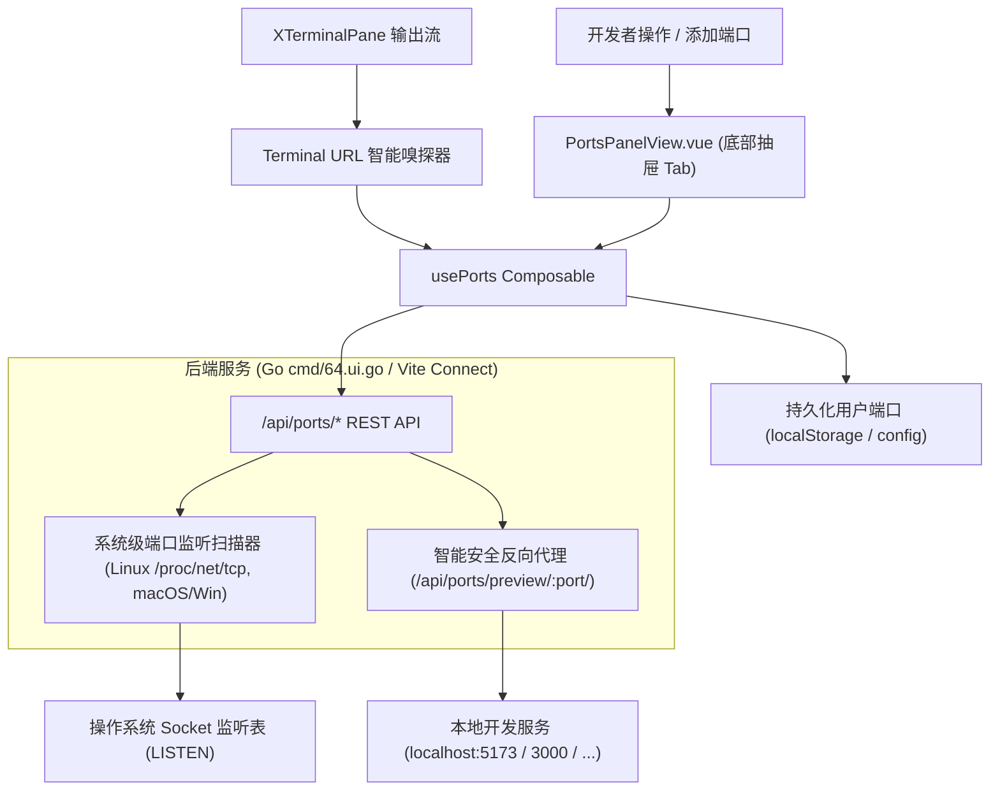

# 技术方案：VS Code 对齐端口转发与智能云端转发系统 (Plan)

## 1. 架构总览与技术栈 (Architecture & Tech Stack)

本系统由前端响应式状态层与 UI 组件、终端嗅探器、云端安全反向代理网关及后端系统级端口扫描引擎共同构成：



---

## 2. 数据结构定义 (Data Structures)

### 2.1 端口实体接口 (`PortItem`)
```typescript
export interface PortForwardItem {
  id: string;                      // 唯一标识 (如 "port-5173")
  port: number;                    // 目标监听端口号 (e.g. 5173)
  localPort?: number;              // 本地转发映射端口 (若发生端口冲突或重映射时使用)
  label: string;                   // 友好标签 (如 "Vite Dev Server")
  protocol: "http" | "https";      // 协议类型
  source: "auto" | "user";         // 来源: 自动转发 (auto) 或 用户手动转发 (user)
  status: "active" | "inactive";   // 状态: 活跃 (实心绿) 或 停止/未就绪 (空心灰)
  visibility: "private" | "public";// 可见性: 私有 (private) 或 公开 (public)
  process?: string;                // 占用进程命令行或程序名 (如 "node vite", "python app.py")
  pid?: number;                    // 关联进程 PID
  forwardAddress: string;          // 转发地址 (如 "localhost:5173" 或 "127.0.0.1:5173")
  previewUrl: string;              // 浏览器直达预览 URL
  icon?: string;                   // 智能识别的服务图标标识 (如 "vue", "react", "python", "database")
}
```

---

## 3. 后端 API 接口契约定义 (API Contract)

| 接口路径 | 方法 | 请求参数 / Body | 返回结构 | 说明 |
| :--- | :---: | :--- | :--- | :--- |
| `/api/ports/list` | GET | 无 | `{ success: boolean, listening: SystemListeningPort[] }` | 扫描操作系统当前所有处于 `LISTEN` 状态的 TCP 端口及进程 |
| `/api/ports/forward` | POST | `{ port: number, localPort?: number, label?: string, protocol?: string, visibility?: string }` | 添加或激活手动端口转发 |
| `/api/ports/update` | POST | `{ port: number, label?: string, localPort?: number, protocol?: string, visibility?: string }` | 更新端口转发配置 |
| `/api/ports/stop` | POST | `{ port: number }` | `{ success: boolean }` | 暂停/停止该端口的转发中继 |
| `/api/ports/unforward`| POST | `{ port: number }` | `{ success: boolean }` | 删除/移除端口转发项 |
| `/api/ports/preview/:port/*` | GET/POST | 通配路径 | 反向代理流转发至 `127.0.0.1:port` | 云端开发智能安全预览反向代理路由 |

---

## 4. 关键子模块设计与实现策略

### 4.1 系统级端口探测器（跨平台支持）
- **Linux 生产环境**：优先解析 `/proc/net/tcp` 与 `/proc/net/tcp6`（无需创建子进程，0 资源开销微秒级获取 inode），再根据 `/proc/[pid]/fd` 反查进程名与命令行；在无权限或简易模式下，降级调用 `ss -tulpn` 或 `lsof -iTCP -sTCP:LISTEN -P -n`。
- **macOS / Windows 环境**：通过标准 `lsof` / `netstat -ano` 解析。
- **开发环境**：在 `vite.config.ts` 中通过 Node.js 内置网络与进程检查提供同构的 `/api/ports/*` 假数据或真实宿主扫描。

### 4.2 智能服务识别算法（指纹库）
前端与后端内置常见服务指纹匹配引擎：
- 端口 `5173` / `5174` -> `Vite Dev Server`，图标 `vue` / `vite`；
- 端口 `3000` / `3001` -> `React / Next.js Web App`，图标 `react` / `nextjs`；
- 端口 `8000` / `8080` / `5000` -> 结合进程命令行判断：若包含 `uvicorn` / `python` 识别为 `FastAPI/Django`，若包含 `node` 识别为 `Node API`，若包含 `go` 识别为 `Go API`；
- 端口 `3306` -> `MySQL Database`；`5432` -> `PostgreSQL`；`6379` -> `Redis`；`27017` -> `MongoDB`；
- 端口 `8888` -> `Jupyter Notebook / Lab`。

### 4.3 云端开发反向代理（安全预览网关）
- 当 UniRTM 部署在云主机、远程开发机或 Docker 容器中时，远程的 `127.0.0.1:5173` 外部浏览器无法直接连通。
- UniRTM 后端提供内置反向代理 `/api/ports/preview/:port/`，自动重写请求头（`Host`, `X-Forwarded-For`）并支持 HTTP/WebSocket 双向穿透。
- 允许一键复制云端预览链接或手机扫码预览。
