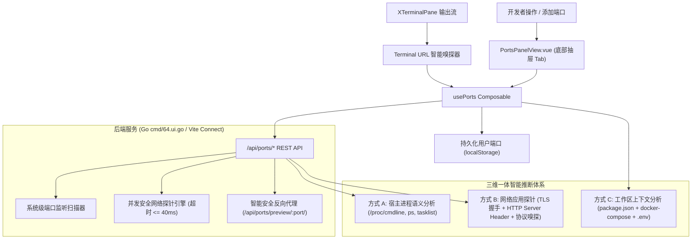

# 技术方案：VS Code 对齐端口转发与智能云端转发系统 (Plan)

## 1. 架构总览与技术栈 (Architecture & Tech Stack)

本系统构建了由**三维一体智能推断体系 (方式 A + 方式 B + 方式 C)** 驱动的现代端口转发引擎：



---

## 2. 数据结构定义 (Data Structures)

### 2.1 端口实体接口 (`PortItem`)
```typescript
export interface PortProbeInfo {
  protocol: "http" | "https" | "tcp";
  isTls: boolean;
  serverHeader?: string;       // e.g. "uvicorn", "nginx/1.24", "Werkzeug/3.0"
  xPoweredBy?: string;         // e.g. "Express", "Next.js"
  contentType?: string;        // e.g. "text/html", "application/json"
  detectedFramework?: string;  // e.g. "FastAPI", "Express", "Django", "Redis"
}

export interface WorkspaceServiceHint {
  port: number;
  serviceName: string;         // e.g. "前端门户 (Vite)", "主数据库 (Postgres)"
  sourceFile: "package.json" | "docker-compose.yml" | ".env";
  icon?: string;
}

export interface PortForwardItem {
  id: string;                      // 唯一标识 (如 "port-5173")
  port: number;                    // 目标监听端口号 (e.g. 5173)
  localPort: number;               // 本地转发映射端口
  label: string;                   // 友好标签 (结合 方式 A/B/C 综合生成的业务标签)
  protocol: "http" | "https";      // 协议类型 (结合 方式 B 自动升级为 https)
  source: "auto" | "user" | "workspace"; // 来源
  status: "active" | "inactive";   // 状态
  visibility: "private" | "public";// 可见性
  process?: string;                // 进程名称
  commandLine?: string;            // 进程命令行
  pid?: number;                    // PID
  forwardAddress: string;          // 转发地址
  previewUrl: string;              // 浏览器预览 URL
  icon?: string;                   // 技术栈图标
  probe?: PortProbeInfo;           // 方式 B 探针检测结果
  workspaceHint?: WorkspaceServiceHint; // 方式 C 工作区上下文推断结果
}
```

---

## 3. 后端 API 接口契约定义 (API Contract)

| 接口路径 | 方法 | 请求参数 / Body | 返回结构 | 说明 |
| :--- | :---: | :--- | :--- | :--- |
| `/api/ports/list` | GET | `?probe=bool` | `{ success: boolean, listening: SystemListeningPort[] }` | 扫描操作系统监听端口，当 `probe=true` 时并发执行方式 B 网络探针 |
| `/api/ports/probe` | POST | `{ port: number }` | `{ success: boolean, probe: PortProbeInfo }` | 对指定端口单独执行深入协议与服务头探针 |
| `/api/ports/workspace-hints` | GET | 无 | `{ success: boolean, hints: WorkspaceServiceHint[] }` | 方式 C：解析工作区配置文件生成预期服务占位 |
| `/api/ports/forward` | POST | `{ port: number, ... }` | `{ success: boolean }` | 添加或激活端口转发 |
| `/api/ports/update` | POST | `{ port: number, ... }` | `{ success: boolean }` | 更新端口转发配置 |
| `/api/ports/stop` | POST | `{ port: number }` | `{ success: boolean }` | 暂停/停止转发 |
| `/api/ports/unforward`| POST | `{ port: number }` | `{ success: boolean }` | 删除端口转发 |
| `/api/ports/preview/:port/*` | GET/POST | 通配路径 | 反向代理流转发至目标端口 | 云端开发智能安全预览反向代理路由 |

---

## 4. 三维一体推断引擎设计

### 4.1 方式 B：网络层协议探针 (Protocol Probing Engine)
- **并发与超时控制**：采用 Go `goroutine` + `select timeout(40ms)` 并发测试。
- **阶段 1：TLS / HTTPS 探针**：
  - 建立 TCP 连接后，发送标准 TLS 1.2 / 1.3 ClientHello 握手包。
  - 若对方返回 ServerHello 或 TLS Alert，直接 100% 确认该端口支持并要求 `HTTPS`，将协议切换为 `https`。
- **阶段 2：HTTP 服务头探针**：
  - 若非 TLS，发送标准 `HEAD / HTTP/1.1\r\nHost: 127.0.0.1\r\nConnection: close\r\n\r\n`。
  - 解析响应头：
    - `Server: uvicorn` -> `FastAPI / Uvicorn`
    - `Server: Werkzeug/x.x.x` -> `Flask App`
    - `X-Powered-By: Express` -> `Express.js App`
    - `X-Powered-By: Next.js` -> `Next.js App`
    - `Server: nginx` -> `Nginx Gateway`
    - `Server: Caddy` -> `Caddy Web Server`
- **阶段 3：非 HTTP 数据库服务特征探测**：
  - 发送 Redis `PING\r\n`，若收到 `+PONG` 确认为 Redis；
  - 检查服务端返回的握手包开头的协议版本号（如 MySQL 初始握手包的协议 10）。

### 4.2 方式 C：工作区上下文推断 (Workspace Context Engine)
- **自动扫描工作区根目录**：
  - **`package.json`**：
    - 遍历 `scripts`：如 `"dev": "vite"` -> `5173` 关联到 `"前端门户 (Vite)"`；`"storybook": "storybook dev -p 6006"` -> `6006` 关联到 `"组件库文档 (Storybook)"`；
    - 分析常用端口参数：正则提取 `--port (\d+)`、`-p (\d+)`。
  - **`docker-compose.yml` / `compose.yaml`**：
    - 解析 `services`：如 `db: image: postgres, ports: ["5432:5432"]` -> 预置 `5432` 对应 `"主数据库 (compose: db)"`；
    - `redis: ports: ["6379:6379"]` -> 预置 `6379` 对应 `"缓存数据库 (compose: redis)"`。
  - **`.env` / `.env.local`**：
    - 提取 `PORT=...`, `VITE_PORT=...`, `APP_PORT=...`。
- **三者综合加权（Multi-Source Fusion）**：
  - 标签生成优先级：`用户自定义标签 > 方式 C 工作区业务名 > 方式 B 探针精确框架 > 方式 A 进程名 > 默认保底`。
