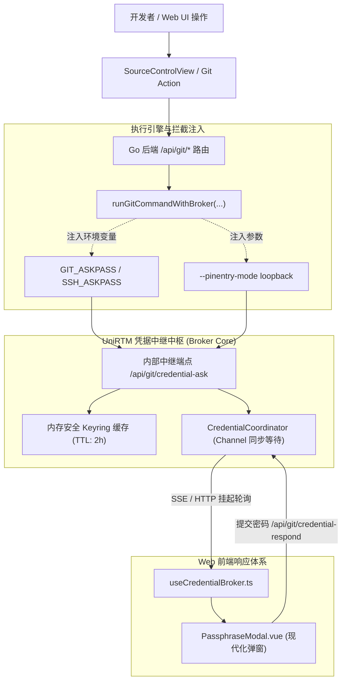

# 技术方案：Git SSH 与 GPG 私钥密码中继与交互管理系统 (Plan)

## 1. 架构总览与技术栈 (Architecture & Tech Stack)

本系统由前端 **Web 交互中继**、后端 **协调通道 (Coordinator)** 以及底层 **Git/SSH/GPG 执行拦截引擎** 构成：



---

## 2. 数据结构定义 (Data Structures)

### 2.1 前后端通信结构
```typescript
export type CredentialType = "ssh" | "gpg" | "git-auth";

export interface CredentialRequest {
  id: string;               // 唯一凭据事务 ID (如 "cred-1729312345-abc")
  type: CredentialType;     // "ssh" | "gpg" | "git-auth"
  prompt: string;           // 原始提示文本 (例如 "Enter passphrase for key '/root/.ssh/id_ed25519':")
  targetKey?: string;       // 解析出的具体密钥标识或路径 (例如 "/home/user/.ssh/id_ed25519")
  timestamp: number;
}

export interface CredentialResponse {
  id: string;
  passphrase: string;
  rememberSession: boolean; // 是否在当前会话中记住此密码
  canceled?: boolean;       // 用户是否取消
}
```

---

## 3. 后端技术实现关键 (Go Backend)

### 3.1 凭据协调器 `CredentialCoordinator`
- 维护一个全局线程安全字典 `map[string]chan string`；
- 当底层 AskPass 触发时，生成事务 `id`，将请求挂起在 `chan string` 上，等待前端回复（设置默认 60s 超时保护）；
- 收到前端提交的密码后，向 channel 写入密码，底层命令即可继续执行。

### 3.2 内存缓存器 `SessionKeyring`
- 以 `keyPath` 或 `keyFingerprint` 作为缓存键；
- 存储于内存安全的切片或映射中，带 TTL 定时器自动抹除；
- 当新凭证请求命中缓存时，0ms 秒级自动完成输入，跳过前端弹窗。

---

## 4. 前端交互实现关键 (Vue 3 Frontend)

### 4.1 通用弹窗组件 `PassphraseModal.vue`
- 基于 Teleport 挂载到 body；
- 包含密钥图标（SSH 钥匙 / GPG 盾牌印章）、密码强度或输入状态指示；
- 提供一键显示/隐藏密码眼睛按钮、大写锁定（Caps Lock）提示；
- 提供 `[✓] 在本次会话中记住此密码` 复选框；
- 键盘快捷键绑定：`Enter` 确认、`Escape` 取消。

### 4.2 组合式函数 `useCredentialBroker.ts`
- 轮询或长连接监听当前是否有正在挂起的 `pendingRequest`；
- 暴露 `respondCredential(id, passphrase, remember)` 与 `cancelCredential(id)`；
- 统一向 SCM 面板、底栏状态栏和全局弹窗调度凭据流程。
